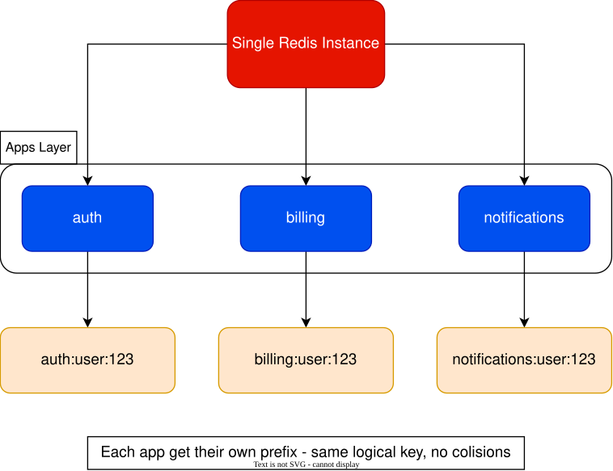
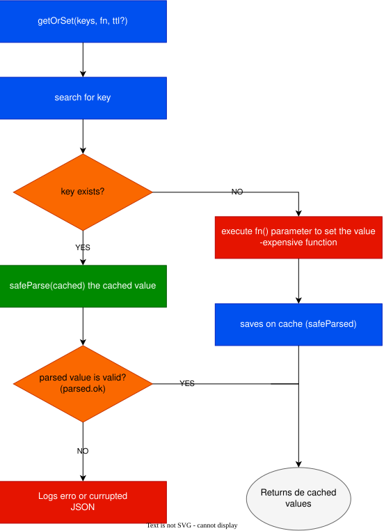

# RedisOver

[](https://www.npmjs.com/package/redisover)
[](https://www.typescriptlang.org/)
[](LICENSE)

**One Redis server for N projects** — with smart parsing (even for object keys) and smart set/get.

Simple, but powerful. Built on top of [ioredis](https://github.com/luin/ioredis).

## The idea

Redis has a single shared keyspace. If two apps use the same key (`user:123`), one overwrites the other.

RedisOver fixes that: give each project a `prefix`, and every key is automatically namespaced. All your projects can share one Redis server without ever colliding.



```typescript
const authRedis = new RedisOver({
  options: { host: 'localhost', port: 6379 },
  prefix: 'auth-app',
});

const billingRedis = new RedisOver({
  options: { host: 'localhost', port: 6379 },
  prefix: 'billing-app',
});

await authRedis.set('user:123', { role: 'admin' });
await billingRedis.set('user:123', { plan: 'pro' });

// Same Redis, zero conflicts:
// auth-app:user:123
// billing-app:user:123
```

## Install

```bash
npm install redisover
```

## Quick Start

```typescript
import { RedisOver } from 'redisover';

const redis = new RedisOver({
  options: { host: 'localhost', port: 6379 },
  prefix: 'my-app', // every key becomes "my-app:<key>"
});

// Smart set: values are serialized to JSON automatically
await redis.set('user:123', { name: 'John Doe', age: 30 }, 60); // TTL: 60s

// Smart get: values come back already parsed
const user = await redis.get('user:123'); // { name: 'John Doe', age: 30 }

await redis._close();
```

### Object keys? No problem

Keys don't have to be strings — pass an object and RedisOver flattens it for you:

```typescript
await redis.set({ type: 'user', id: 123 }, { name: 'Jane Doe' });
// stored as "my-app:type_user:id_123"

const jane = await redis.get({ type: 'user', id: 123 });
```

### Get-or-set in one call: `getOrSet()`

`getOrSet()` returns the cached value if it exists — otherwise it calls your factory, stores the result, and returns it. The factory can be synchronous or asynchronous and only runs on a cache miss (or invalid cached JSON).

Object keys are flattened (e.g. `{ type: 'user', id: 1 }` → `type_user:id_1`) and factory results are JSON-serialized by `set()`. Pass the value itself, without calling `JSON.stringify()`.



```typescript
const result = await redis.getOrSet('report', () => ({ total: 42 }), 3600);
console.log(result); // { total: 42 }

// On a cache hit, the factory is not called and the existing TTL is unchanged.
const cached = await redis.getOrSet('report', () => ({ total: 99 }), 3600);
console.log(cached); // { total: 42 }
```

Upgrading from 1.x? `parse()` was removed in 2.0. Use `getOrSet()` with a factory instead. It returns the value directly, not the former `{ created, key, value }` wrapper. Factory errors propagate without caching a result.

## API

Every method accepts keys as a `string` **or** a plain `object` (flattened into `field_value` segments).

| Method | What it does |
|---|---|
| `new RedisOver(config?)` | `config.options` — [ioredis options](https://github.com/luin/ioredis#connect-to-redis) · `config.prefix` — your project namespace · `config.logging` — enable logs |
| `set(key, value, ttl?, onlyIfNew?)` | Stores any JSON-serializable value. Returns `'OK'` or `null`; `onlyIfNew: true` skips a key that already exists |
| `get(key)` | Returns the parsed value, or `null` if missing |
| `getOrSet(key, factory, ttl?)` | Returns a cached value, or calls the factory, stores its result, and returns that value |
| `deleteKey(key)` | Deletes one key. Returns whether a key was deleted |
| `exists(key)` | Returns whether the key exists |
| `keys()` | Lists fully prefixed keys in this instance's namespace |
| `clear()` | Deletes keys in this instance's namespace. Without a prefix, deletes all keys in the selected Redis database |
| `_ping()` | Health check — resolves `'PONG'` |
| `_close()` | Closes the connection gracefully |

> Tip: hover any method in your editor — everything is documented with JSDoc, examples included.

## Requirements

- Node.js >= 14
- Redis >= 5

## Contributing

Issues and PRs are welcome on [GitHub](https://github.com/moraeszete/redisover).

## License

[MIT](LICENSE)

---

Made by [Lucas Moraes](https://github.com/moraeszete)
